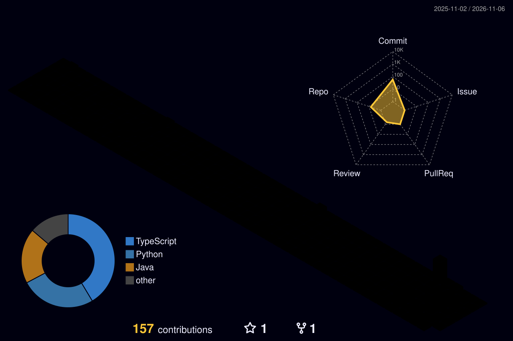

**M.Sc. Data Science (Germany) · Research Assistant @ Fraunhofer · Building with AI**

---

### About me

I build data and AI systems end to end: from time-series forecasting and research prototypes to LLM-powered tools and agents that run in production.

- 🔭 Working on **AI agents, multi-model routing and forecasting (Temporal Fusion Transformers)**
- 🔬 Background in **applied research** at Fraunhofer and a master's in Data Science
- 🛠️ Also into **hardware side-projects** — e.g. a desk dashboard for health metrics
- ✍️ Writing about tech and ideas on **[losthinker](https://open.substack.com/pub/losthinker)**

---

### Featured projects

<table>
<tr>
<td width="50%" valign="top">

**[📈 rize-capital-stock-tft](https://github.com/shadymohammed75/rize-capital-stock-tft)** 
Multi-horizon stock-price forecasting with a Temporal Fusion Transformer. 
Python · PyTorch · Time series

</td>
<td width="50%" valign="top">

**[🖥️ desk-dashboard](https://github.com/shadymohammed75/desk-dashboard)** 
Small desk display showing health metrics (sleep, gym, food) at a glance. 
C · Embedded

</td>
</tr>
<tr>
<td width="50%" valign="top">

**[⚡ twinspark](https://github.com/shadymohammed75/twinspark)** 
Big Data Systems project built on Akka and Spark. 
Java · Akka · Spark

</td>
<td width="50%" valign="top">

**[🎙️ Voice-assistant](https://github.com/shadymohammed75/Voice-assistant)** 
Voice assistant for weather and calendar management via APIs. 
Python · Speech · APIs

</td>
</tr>
</table>

---

### Tech stack

---

### GitHub activity

<!-- Generated daily by .github/workflows/profile-stats.yml -->

<picture>
  <source media="(prefers-color-scheme: dark)" srcset="https://raw.githubusercontent.com/shadymohammed75/shadymohammed75/output/github-contribution-grid-snake-dark.svg" />
  
</picture>

---

Open to collaborations on data science and AI projects — feel free to reach out.

